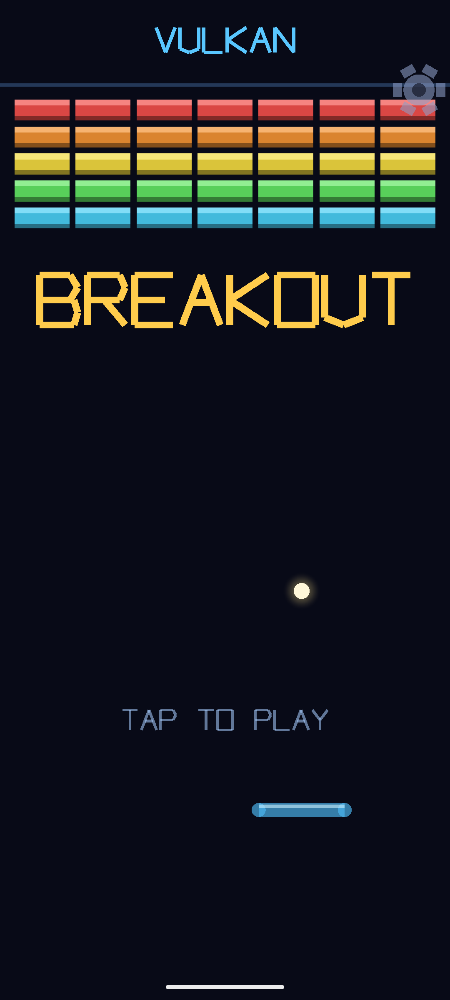
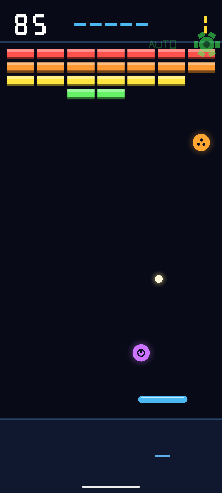
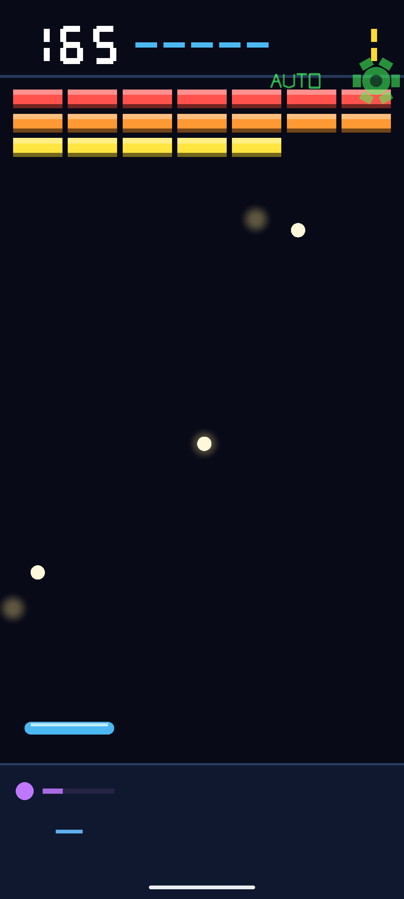
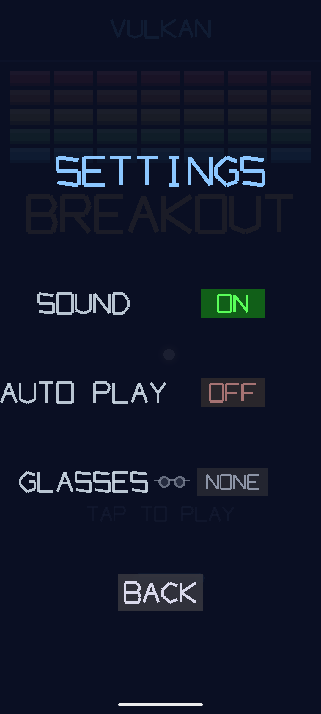

# Vulkan Breakout

[](https://github.com/jpcottin/VulkanBreakout/actions/workflows/ci.yml)

<details>
<summary><b>CI details</b> — host tests, native tests + smoke matrix, API 34 → 37.2, plus Android CLI and Emulator Preview legs</summary>

| Legs | Image | Emulator channel | GPU | Gating |
|---|---|---|---|---|
| Host tests | host build, no emulator | — | — | ✅ blocking |
| Auto Play bench: seeded campaigns, portrait + landscape | host build, no emulator | — | — | ✅ blocking |
| Native tests: API 34, 36 | `default` x86_64 | stable | swiftshader / auto | ✅ blocking |
| Smoke: API 34, 36 | `default` x86_64 | stable | swiftshader / auto | ✅ blocking |
| Smoke: API 37.0 | `google_apis_ps16k` (16 KB page size) | stable | lavapipe | non-blocking |
| Smoke: API 37.0 | `google_apis_ps16k` | canary (`--channel=3`) | lavapipe, auto | non-blocking |
| Smoke: API 37.1 | `google_apis_ps16k` | canary | lavapipe, auto | non-blocking |
| Smoke: API 37.2 | `google_apis_ps16k` | canary | lavapipe, auto | non-blocking |
| Android CLI experiment | `google_apis_ps16k` 37.0 | canary | emulator default | non-blocking |
| Emulator Preview (`emulators;latest`) | `google_apis_ps16k` 37.0 | preview package | auto | non-blocking |
| Emulator Preview multi-run (snapshots) | `google_apis_ps16k` 37.0 | preview package | auto | non-blocking |
| Android CLI multi-run (snapshots) | `google_apis_ps16k` 37.0 | canary | emulator default | non-blocking |

The Android CLI leg drives the whole flow with the [`android` CLI](https://d.android.com/tools/agents/android-cli) (`android sdk install --canary`, `android emulator create/start/stop`) instead of `sdkmanager`/`avdmanager` and the emulator-runner action.

All emulator-runner legs use full diagnostics (`-verbose -show-kernel -debug-metrics -metrics-collection`) and a `cmdline-tools;latest` update so `avdmanager` writes a valid `target=android-37.x` (the runner's preinstalled version writes `android-0`, which the emulator clamps to API 3, disabling the Vulkan/GLDirectMem auto-enable the ps16k images need).

</details>

A 2D **Breakout-like** game for **Android**, rendered with **Vulkan**.

Slide the paddle left and right, keep the ball in play and break the wall of
coloured bricks, across ten increasingly difficult levels. Sibling project of
[VulkanSpaceInvaders](https://github.com/jpcottin/VulkanSpaceInvaders) and
[VulkanAsteroids](https://github.com/jpcottin/VulkanAsteroids) — same
hand-written renderer, procedural audio engine, AI-Glasses bridge and CI
architecture, with a brand-new game on top.

## Screenshots

Captured on an Android emulator (API 37, x86_64) with **Auto Play** driving
the rounds.

| Title | Auto Play: capsules on the way down |
|:---:|:---:|
|  |  |

| Auto Play: three balls up, slow ball running | Settings |
|:---:|:---:|
|  |  |

## Gameplay

| Control | Action |
|---------|--------|
| Hold the **strip below the paddle** (bottom ~15% of screen) | The paddle slides toward your finger while pressed |
| Tap anywhere (or hold the strip) | Launch a ball resting on the paddle |
| Tap the **gear icon** (top-right) | Open Settings from any screen |
| Tap anywhere on the title / game-over screen | Start / return to title |

- **Goal:** break every brick in the wall before you run out of balls.
- **Progression:** 10 levels, easy to hard. Level 1 is 4 rows of plain
  bricks; the wall grows to 9 rows by level 10, with **tough** bricks (two
  hits) from level 3, **armoured** bricks (three hits) from level 7,
  unbreakable **steel** blocks in the way from level 5 and holes in the
  bottom row on some levels. The ball starts faster on every level and
  **speeds up as the wall thins** (up to +20%).
- **The wall fits the screen:** bricks have a fixed size and as many columns
  as fit are laid out — 7 on a portrait phone. A wide screen (an unfolded
  foldable, landscape) plays in a **central lane** of 10 columns with shaded
  margins outside it, rather than a wall three times wider than a paddle can
  cover; the paddle keeps the same speed relative to the lane. A fold or
  unfold mid-level rebuilds the wall for the new width (score and lives
  stay).
- **Bricks:** one bright colour per row (red, orange, yellow, green, cyan,
  blue, purple, pink, white) with a bevelled top and a dark bottom edge so the
  wall reads as solid blocks; bricks that take more than one hit show an
  inner core per hit left; steel is grey with rivets. Plain 10 pts · tough
  20 pts · armoured 30 pts — all ×level.
- **Aim with the paddle:** where the ball meets the paddle sets the rebound —
  the centre sends it (almost) straight up, the tips 65° out. The ball never
  leaves the paddle perfectly vertical and never shuttles near-horizontally
  after a bounce, so there are no dead loops.
- **Bonuses:** 12% drop chance on each broken brick: 🔵 **Wide paddle**
  (+60% width, 10 s) · 🟣 **Slow ball** (×0.6 speed, 8 s) · 🟠 **Multi-ball**
  (every ball in play splits into three, up to six) · 🟢 **Extra life** (rare,
  up to 9). +25 pts ×level on pickup; the timed bonuses show as HUD bars
  and end with the ball.
- **Lives:** 5 balls. A ball that passes the paddle is gone — a fresh one is
  served on the paddle and launches on your next tap. Losing one of several
  balls costs nothing. The game ends when the last ball is lost.
- **Level clear:** +100 pts ×level. Clearing level 10 wins the game.
- **HUD:** score (top-left) · balls left as mini paddles (top-center) · level
  (top-right) · active bonuses with timer bars at the left of the control
  strip, the one place the wall, the ball and the capsules never reach.
- **High scores:** top-5 leaderboard persisted locally; gold/silver/bronze
  podium on the title screen; gold pulsing score + rank medal on game over
  when a new record is set.
- **Screen shake** and a **haptic pulse** (50 ms) when a ball is lost; the
  HUD stays stable.
- **Sound:** all effects synthesised in real time — paddle blip, wall tick,
  brick click, a brick-break pop pitched by row (the wall is a keyboard, top
  row highest), ball-lost slide, level-clear and extra-life jingles, pickup
  sparkle, and a 92 BPM ambient bed.
- **Settings:** gear icon opens an overlay from any screen. Toggles: Sound
  on/off, Auto Play. Both persist across app restarts. The game freezes under
  the overlay.
- **Auto Play:** AI autopilot — it plays the way a good player does. It works
  out where the ball will come down (the flight is simulated with the same
  collision rules as the game, bricks included), gets the paddle there, and
  picks *where on the paddle* to take it: the hit offset sets the rebound
  angle, so the offset is the aim. Every candidate rebound is simulated
  against the wall; the one that hits the most bricks per second of flight
  and still comes down somewhere the paddle can reach wins, and when no
  single rebound reaches the last bricks it looks one trip further. It
  never plans a dead-centre hit (those leave at the minimum angle, left or
  right by a hair's width of paddle placement — a coin toss), it keeps the
  other balls of a multi-ball reachable, it collects a bonus capsule when it
  can be under it and still back under the ball in time (an extra life
  first, a bonus already running with time left never), and it launches a
  served ball as soon as the serve delay is over. Predictions are cached per
  ball and redone only on a bounce, so a trip costs a handful of
  simulations. It drives the exact same control path as a finger. Activate
  from Settings; the gear turns green with a pulsing "AUTO" label while
  active. Every change to it is measured with the
  [Auto Play bench](#auto-play-bench-host-build).
- **Play on AI Glasses:** with Display Glasses paired, Settings shows a
  glasses row — *PLAY* hands the whole game to the glasses' projected
  display, where the **touchbar** drives it: finger position steers the
  paddle, contact launches the ball. The phone shows an "ON GLASSES" banner
  and throttles itself; *PHONE* (in Settings) brings the game home. With
  nothing paired the row reads *NONE*.
- **Resumes after process death:** level, score and lives are saved with the
  activity state; the wall comes back fresh.

## Tech

- **Pure native C++17** — Android
  [`NativeActivity`](https://developer.android.com/ndk/reference/group/native-activity)
  with `native_app_glue`; the only production JVM code is the thin AI-Glasses
  bridge (`GlassesBridge.kt`), plus the instrumented smoke test.
- **Hand-written Vulkan 1.0 2D renderer** — one graphics pipeline, one vertex
  buffer holding two shapes (a quad and a disc), per-instance transform +
  translation + RGBA + fill style, FIFO present, two frames in flight.
  Consecutive draws of the same shape batch into one instanced draw call.
- **Everything is geometry, no textures** — bricks are bevelled quads, the
  paddle a rounded bar, the ball a disc under a radial-falloff glow. Stroke
  vector font for text; 7-segment font for HUD numbers.
- **Procedural audio via [Oboe](https://github.com/google/oboe)** — an 8-voice
  synth on a low-latency mono float stream: paddle blip, wall tick, brick
  click, pitched brick-break pop, ball-lost slide, level-clear and extra-life
  jingles, pickup sparkle, and a 92 BPM ambient bed (pad + bass + arpeggio).
  No audio files.
- **GLSL → SPIR-V** compiled at build time with the NDK's `glslc` (`-mfmt=c`)
  and `#include`d directly as C arrays — no runtime shader compiler, no assets.
- **Adaptive to foldables** — the wall is laid out for the surface aspect
  ratio: fixed-size bricks, as many columns as fit. The renderer re-checks the
  surface extent every frame: when a fold/unfold resizes the window in place
  (the activity survives via `configChanges`), the swapchain is rebuilt at
  the new resolution instead of letting the compositor stretch the old one.
- **AI Glasses (Android XR projected)** — the glasses expose a secondary
  display (`ProjectionDisplay`, 30 Hz) owned by a virtual device. A ~70-line
  Kotlin bridge (`GlassesBridge.kt`) uses `androidx.xr.projected` to observe
  pairing and to launch `GlassesGameActivity` — a second `NativeActivity`
  declared with `requiredDisplayCategory="xr_projected"` — onto that display.
  The native side calls the bridge over JNI and detects its role from the
  activity class, and switches the same game to touchbar controls with a
  pure-black clear (black = transparent on additive AR lenses). Phone and
  glasses instances coordinate through one process-wide session flag; the
  phone freezes and sleep-throttles while the glasses play so the projected
  display's encoder gets the GPU. The projected display is a 30 Hz panel, so
  the glasses instance uses a **low-latency swapchain** (minimal image count,
  one frame in flight, MAILBOX present when available, loop paced to ~60 fps)
  and renders into a **centered quarter-size viewport** (a floating window on
  the lenses, 4× fewer pixels to rasterise; draw commands are NDC-based so
  nothing else changes). Emulator tips: input must target the projected
  display — `adb shell input -d <displayId> tap x y` — taps on the glasses
  AVD's own window are not forwarded, and the projection tears down when the
  glasses AVD sleeps (wake it to re-pair).
- **Runtime diagnostics via Logcat** — every launch logs a full Vulkan
  extension audit (`✓ USED` / `~ PRESENT` / `✗ ABSENT` / `? UNKNOWN`) for
  instance and device extensions, and a periodic FPS line (frames/s, average
  frame time, draw calls) every 5 s. Filter with `adb logcat -s Breakout`.
- `minSdk 24` (Vulkan requires API 24+), AGP 9, NDK r29, CMake 3.22.

## Build & run

```bash
# Build
./gradlew assembleDebug

# Install and launch with the Android CLI
android run --apks app/build/outputs/apk/debug/app-debug.apk

# Or with adb
adb install -r app/build/outputs/apk/debug/app-debug.apk
adb shell am start -n com.jpcottin.vulkanbreakout/android.app.NativeActivity
```

Requires a device with a Vulkan driver (API 24+).

## Testing

### Native unit tests (Google Test)

104 tests covering the wall (columns follow the screen width, the lane cap on
wide screens, rows per level, every wall fits the screen, tough/armoured/steel
bricks arriving with the levels, holes, level clamp at 10), serve and launch
(the ball waits on the paddle and follows it, the serve delay, tap and
strip-hold launches), paddle control (steer, stop-on-finger, clamping, zone
boundary, drag, cancel, viewport shrink), the huge-frame dt clamp, ball
physics (side walls, ceiling, paddle bounce and its angle by hit position,
never perfectly vertical, lost ball costs a life and re-serves, game over on
the last life, brick breaking and scoring, two-hit bricks, steel, side hits
reflecting horizontally, speed ramp, per-level speed, no tunnelling at the
clamped worst-case dt), bonuses (capsule fall and pickup, fall-through, wide
paddle and its clamp-back on expiry, slow ball, multi-ball split and cap,
extra life up to nine, losing one of several balls, bonuses ending with the
ball), progression (level-scaled clear bonus, in-flight wipe on clear, win at
level 10, game over grace tap, title-return cleanup, wall rebuild on fold),
process-death session restore (bounds-checked), high-score persistence
(ordering, displacement, cap, cross-instance disk merge, exact-duplicate skip,
reload-from-disk handoff, zero-score guard, tie guard), the Auto Play AI
(self-launch after the serve delay, landing prediction matching the real
flight, going under the ball, catching a ball off the wall, aiming the
rebound at the last brick, never a dead-centre plan, capsule pickup when
there is time and not when the ball comes first, no detour for a running
bonus but always for a life, saving the ball that comes down first,
replanning on a bounce, a clean level-one clear on four seeds, multi-ball,
the lane on a wide screen), the settings state machine (gear tap from title
and in play, freeze under the overlay, toggles, back button, persistence,
reload), the AI-Glasses integration (touchbar steer and launch from
anywhere, strip-mode isolation, no gear on glasses, pure-black clear,
settings row launch/inert/exit behaviour, phone gameplay freeze and banner
during a glasses session) and render coverage of every reachable state.

They build and run on the host in a few seconds — no device, no emulator:

```bash
scripts/host-tests.sh                              # all tests
scripts/host-tests.sh --gtest_filter='Settings.*'  # a subset
```

The same binary runs on a connected device or emulator through Gradle:

```bash
# ARM device (default)
./gradlew runNativeTests

# x86_64 emulator
./gradlew runNativeTests -PtestAbi=x86_64

# Several devices connected? Pin one:
ANDROID_SERIAL=emulator-5556 ./gradlew runNativeTests
```

### Auto Play bench (host build)

`scripts/autoplay-bench.sh` compiles `game.cpp` with the host compiler (no
Android SDK, no emulator — `app/src/main/cpp/test/host/` stands in for
`<android/log.h>`) and plays seeded, headless rounds with the autopilot. It
reports, per level and per campaign, how often the autopilot clears the wall,
how many balls it loses, how long a clear takes, bricks per minute and paddle
hits:

```bash
scripts/autoplay-bench.sh --runs 100 --levels --campaigns     # portrait phone
scripts/autoplay-bench.sh --width 2400 --height 1080 --campaigns   # landscape
scripts/autoplay-bench.sh --runs 50 --levels --trace          # dump every lost ball
```

Runs are seeded, so two builds of the same code give the same numbers and a
change to the autopilot is a before/after comparison. CI plays 100 portrait
and 50 landscape campaigns and fails when fewer than 95% are won. Numbers for
the current autopilot (campaigns won / balls lost per campaign / average
length of a won campaign):

| Screen | Campaigns | Won | Balls lost | Length |
|---|---|---|---|---|
| Portrait 1080×2400 | 100 | 99% | 0.18 | 14 min |
| Foldable inner 2152×2076 | 50 | 100% | 0.30 | 19 min |
| Landscape 2400×1080 | 50 | 100% | 0.30 | 19 min |

A level takes the autopilot about a minute on level 1 and a minute and a
half on level 10 on a phone; the 10-column lane of a wide screen takes
roughly twice as long. The one portrait loss is a level that ran past the
bench's 8-minute cap, not a game over.

### Instrumented smoke test

Launches the `NativeActivity` on a connected device, waits for the renderer
to present its first frame, asserts the activity is still `RESUMED`, and
captures a screenshot:

```bash
./gradlew connectedAndroidTest
```

## CI/CD

GitHub Actions runs on every push and pull request to `main`. The first five
jobs gate merges. The last four explore newer Android emulator tooling and are
marked `continue-on-error`, so a preview package that moves underneath us
reports its findings without ever blocking a PR.

| Job | What it does | Artifacts |
|-----|-------------|-----------|
| **Build APK** | Compiles the debug APK | `debug-apk` |
| **Host tests** | Builds `game.cpp` and the Google Test suite with the host compiler and runs it | — |
| **Native Tests** | Runs the same 104 Google Test cases on x86\_64 emulators (API 34 + API 36) | — |
| **Auto Play bench** | Builds `game.cpp` on the host and plays 100 portrait and 50 landscape seeded campaigns with the autopilot; fails when fewer than 95% are won | — |
| **Smoke Test** | Runs the Android instrumented test on x86\_64 emulators and captures an in-game screenshot via `UiAutomation`. The test asserts the activity is RESUMED **and** that the renderer logged `First frame presented`, so a dead Vulkan path fails loudly. Blocking on API 34 + 36; non-blocking legs on API 37.0, 37.1 and 37.2 (`google_apis_ps16k`, 16 KB pages) across the lavapipe and auto GPU backends, from both the stable and canary channels | `smoke-screenshot-api*`, `smoke-test-results-api*`, `smoke-logcat-api*` (suffixed per leg) |
| **Android CLI experiment** | Drives the same instrumented test through the `android` CLI — SDK install, AVD creation, boot and teardown — instead of `sdkmanager`/`avdmanager` plus the emulator-runner action | `cli-smoke-*` |
| **Emulator Preview** | Boots the Android Emulator Preview package (`emulators;latest`, which installs alongside the stable emulator under `emulators/latest/`) and runs the instrumented test against it | `preview-smoke-*` |
| **Emulator Preview multi-run** | Four boot cycles against the same AVD with quickboot snapshots enabled: each cycle plays the game briefly, screenshots it, then shuts down so the emulator saves its snapshot. Checks whether a live Vulkan app survives snapshot save/restore | `preview-multirun-screenshots`, `preview-multirun-emulator-logs` |
| **Android CLI multi-run** | The same four-cycle snapshot experiment driven entirely by the `android` CLI (`emulator start` / `stop`, `run`, `screen capture`, `layout`) against the canary emulator | `cli-multirun-screenshots`, `cli-multirun-logs` |

The preview jobs share their setup through the composite action in
`.github/actions/preview-emulator`, which installs the system image, creates
the AVD, installs the preview emulator and its host dependencies.

### Replaying the Emulator Preview job locally

Pushing to see what a preview emulator does is a slow way to iterate, so the
multi-run job can be replayed on a local machine in a few minutes:

```bash
scripts/replay-preview-multirun.sh            # 4 cycles, throwaway AVD, cleaned up after
scripts/replay-preview-multirun.sh -n 2 -k    # 2 cycles, keep the AVD for inspection
scripts/replay-preview-multirun.sh -h         # options
```

It needs `emulators;latest`, the API 37.0 `google_apis_ps16k` system image and
KVM. Every `adb` call is pinned to the emulator it launches and shutdown is
scoped to that emulator's process group, so it is safe to run while other
devices or emulators are attached.

## License

[Apache License 2.0](LICENSE).
